<p align="center">
  
</p>

<h1 align="center">Grouply</h1>

<p align="center">
  <strong>Make group work actually work.</strong><br>
  A coordination app for student group projects: who does what, what was submitted,<br>
  what is waiting for review, and where the discussion lives.
</p>

<p align="center">
  
  
  
  
  
  <a href="LICENSE"></a>
</p>

<p align="center">
  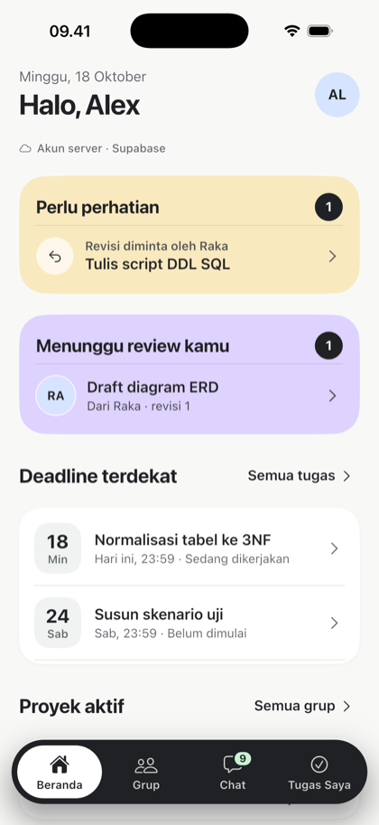
  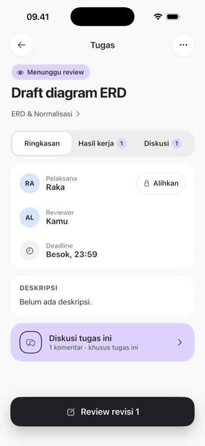
  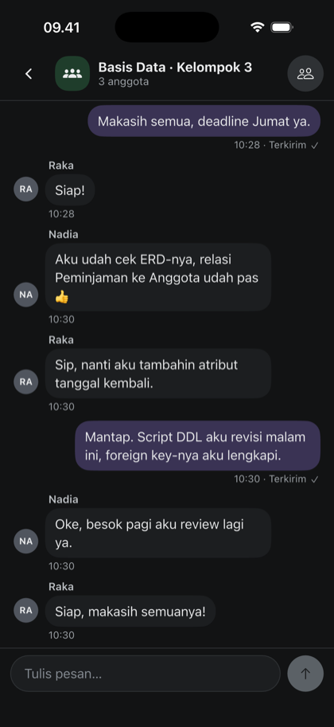
  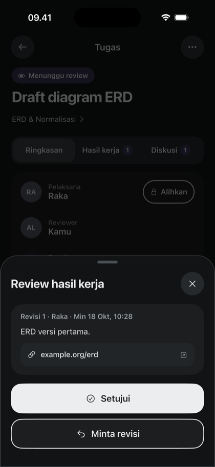
</p>

---

## Why Grouply

Group assignments usually live in a chat thread: tasks get buried, results are hard to find, and nobody is sure what is still waiting for review. Grouply does not replace WhatsApp or Google Docs. It is the coordination layer on top of them:

- **Clear ownership.** Every task has one assignee, one reviewer and a deadline.
- **Submit → review → approve or revise.** Work is submitted as an append-only, versioned record with a note and HTTPS links, and reviewed against the current version only.
- **Discussion where it belongs.** A realtime group chat per group, plus a discussion thread on each task.

The app interface is in Bahasa Indonesia.

## Features

| Area | What is included |
|---|---|
| **Groups** | Create or join with an invite code (7-day expiry, revocable, usage limit, max 8 members), coordinator transfer, guarded leave/remove |
| **Projects** | Progress tracking, completion only when every task is done, explicit reopen, archive that restores the previous status |
| **Tasks** | Create, edit and reassign (coordinator only), start, versioned submissions, approve or request revision with feedback |
| **Chat** | Realtime group chat, unread counters, failed-send retry with deduplication, report and block |
| **Account** | Email sign-in, sign-up, password reset with an emailed 6-digit code, profile editing, account deletion that keeps shared history anonymised |
| **Appearance** | Light and dark mode that follow the system, Soft Future design system shared by both clients |

Business rules (membership checks, read-only completed/archived projects, review locks, invite limits) are enforced on the server by row-level security and transactional RPCs. The clients only add input validation.

## Screenshots

<table>
  <tr>
    <th>Welcome</th><th>Home</th><th>My tasks</th>
  </tr>
  <tr>
    <td>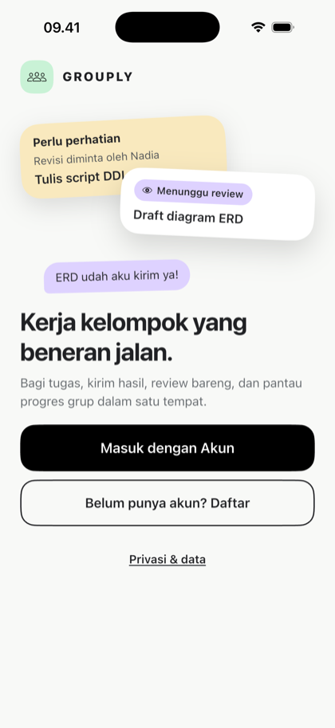</td>
    <td></td>
    <td>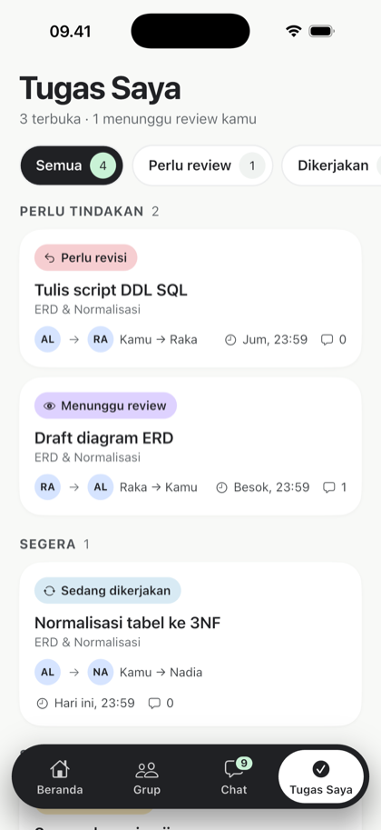</td>
  </tr>
  <tr>
    <td>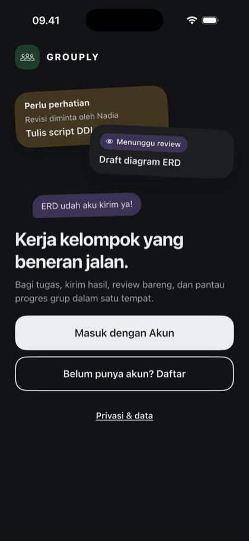</td>
    <td>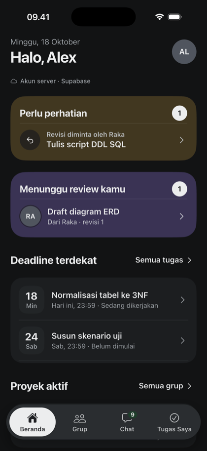</td>
    <td>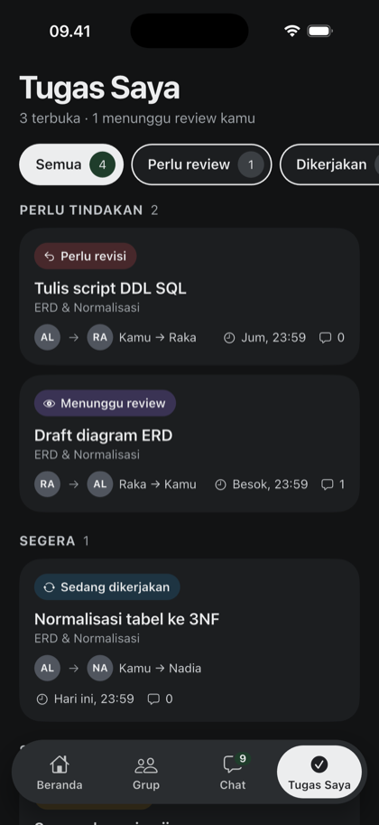</td>
  </tr>
  <tr>
    <th>Task detail</th><th>Peer review</th><th>Group chat</th>
  </tr>
  <tr>
    <td></td>
    <td>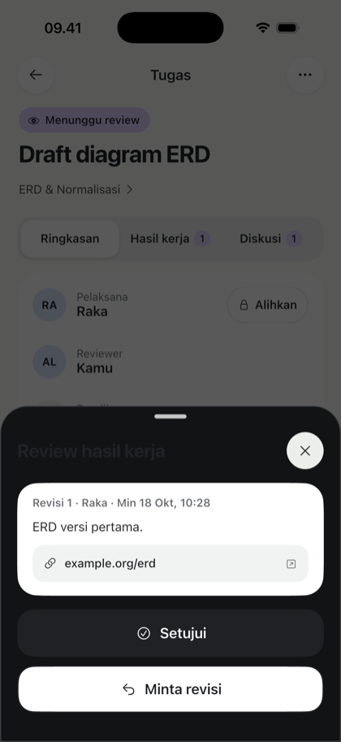</td>
    <td>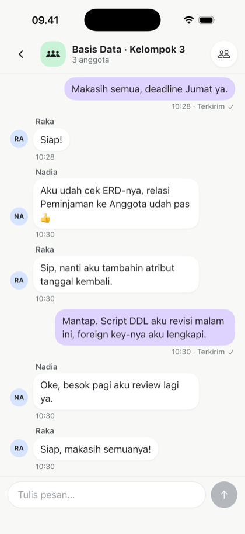</td>
  </tr>
  <tr>
    <td>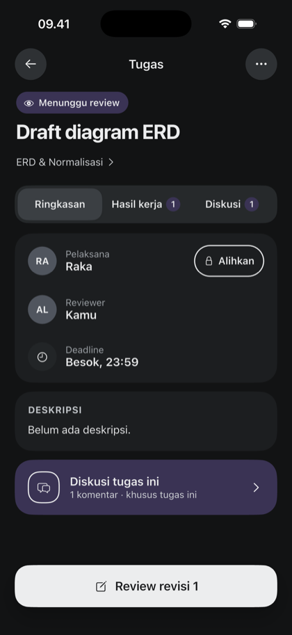</td>
    <td></td>
    <td></td>
  </tr>
</table>

<sub>Flutter client on the iPhone 17 simulator with sample data.</sub>

## Architecture

```
┌──────────────────────┐   ┌──────────────────────┐
│  SwiftUI (iOS 17+)   │   │ Flutter (iOS/Android)│
└──────────┬───────────┘   └──────────┬───────────┘
           │   Supabase Auth · RPC · Realtime    │
           └──────────────────┬──────────────────┘
                 ┌────────────┴────────────┐
                 │ Supabase (PostgreSQL)   │
                 │ RLS · grouply_snapshot  │
                 │ grouply_mutate · events │
                 └─────────────────────────┘
```

- **Two clients, one contract.** Both apps call the same public RPCs (`grouply_snapshot`, `grouply_mutate`) with camelCase payloads, so the server is the single source of truth.
- **Server-first writes.** The UI waits for the server before showing a change; there is no local write fallback.
- **Secure sessions.** Tokens live in the Keychain (iOS) or secure storage (Flutter), never in preferences or files.
- **Realtime.** Chat messages, read receipts and sync state arrive over WebSockets and trigger a snapshot refresh; reconnects catch up on missed changes.

| Layer | Stack |
|---|---|
| iOS client | Swift, SwiftUI, URLSession WebSocket, XcodeGen |
| Cross-platform client | Flutter 3.41, Dart 3.11, `supabase_flutter`, `flutter_secure_storage` |
| Backend | Supabase Auth, PostgreSQL with RLS, PL/pgSQL RPCs, Realtime |
| Tests | XCTest, `flutter_test`, SQL assertions, local HTTP and integration suites |

## Getting started

### Prerequisites

- macOS with Xcode (iOS 17+ SDK) and the iOS Simulator
- [Flutter](https://docs.flutter.dev/get-started/install) 3.41+ (and Android Studio for Android)
- [Supabase CLI](https://supabase.com/docs/guides/cli) and Docker (or OrbStack)
- Python 3 for the local setup scripts

### 1. Start the local backend

```sh
supabase start -x storage-api,imgproxy,postgres-meta,studio,edge-runtime,logflare,vector,supavisor
python3 scripts/backend_local.py setup
```

The setup script writes the public client configuration (`Config/Local.xcconfig`, `flutter/dart_defines.local.json`) and stores local test-account credentials privately outside the repository. Grouply uses its own ports (API `55321`, database `55322`, local mail `55324`) so it does not clash with other Supabase projects. Details: [docs/BACKEND_SETUP.md](docs/BACKEND_SETUP.md).

### 2. Run the Flutter app (iOS or Android)

```sh
cd flutter
flutter pub get
flutter run --dart-define-from-file=dart_defines.local.json
```

On the Android emulator the local API is `http://10.0.2.2:55321`. More in [flutter/README.md](flutter/README.md).

### 3. Run the SwiftUI app (iOS)

Open `Grouply.xcodeproj`, select the `Grouply` scheme and an iPhone simulator, then run and choose **Masuk dengan Akun**. If you change target configuration, edit `project.yml` and regenerate with `xcodegen generate`.

## Testing

```sh
# Flutter: static analysis and unit/widget tests
cd flutter && flutter analyze && flutter test

# Flutter: real integration tests against the local backend (opt-in)
GROUPLY_LOCAL_INTEGRATION=1 flutter test test/local_backend_test.dart

# SwiftUI: unit, integration and UI tests
xcodebuild -project Grouply.xcodeproj -scheme Grouply \
  -destination 'platform=iOS Simulator,name=iPhone 17 Pro' \
  -derivedDataPath build test CODE_SIGN_IDENTITY=- CODE_SIGNING_ALLOWED=YES
```

The SQL suites in `supabase/tests/` cover RLS, workflow rules and account deletion. Integration tests only run against the local backend and write their own fixtures to it.

## Project status

Grouply is in active development and is **not yet released**.

| Ready and tested locally | Not done yet |
|---|---|
| Auth, RLS and transactional RPCs on local Supabase | Deployment to a Supabase cloud project |
| Realtime group chat with unread sync and reconnect | Testing on physical devices and real networks |
| Sign-up and password reset (Flutter) | Sign in with Apple and token revocation |
| Account deletion and moderation queue (local CLI) | Push notifications (APNs/FCM) |
| Light and dark mode in both clients | App Store / Play Store builds |

Verification evidence and known gaps are tracked in [docs/IMPLEMENTATION_STATUS.md](docs/IMPLEMENTATION_STATUS.md) and [docs/FLUTTER_MIGRATION.md](docs/FLUTTER_MIGRATION.md).

## Repository layout

```
Grouply/            SwiftUI app (App, Core, Features, Resources)
GrouplyTests/       XCTest unit and integration tests
GrouplyUITests/     XCTest UI tests
flutter/            Flutter client for iOS and Android
supabase/           Migrations, SQL tests, config and email templates
scripts/            Local backend setup and operator tools
docs/               Product and technical specification
reference/          Original design prototype (reference only)
```

## Documentation

The specification is written in Bahasa Indonesia.

| Document | Contents |
|---|---|
| [PRD](docs/PRD.md) | Product requirements and business rules |
| [User flow](docs/USER_FLOW.md) | Screens and flows |
| [Architecture](docs/ARCHITECTURE.md) | System design and contracts |
| [Database schema](docs/DATABASE_SCHEMA.md) | Target data model |
| [Design system](docs/DESIGN_SYSTEM.md) · [Dark theme](docs/DARK_THEME.md) | Soft Future tokens and components |
| [Roadmap](docs/ROADMAP.md) | Milestones and test plan |
| [Backend setup](docs/BACKEND_SETUP.md) | Local Supabase, accounts and security tests |

## License

Licensed under the [Apache License 2.0](LICENSE).
