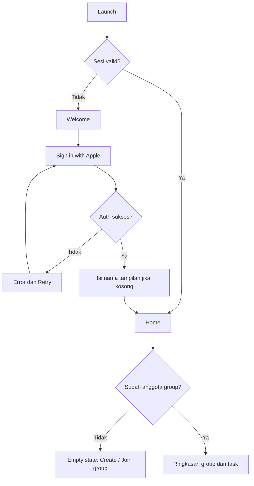
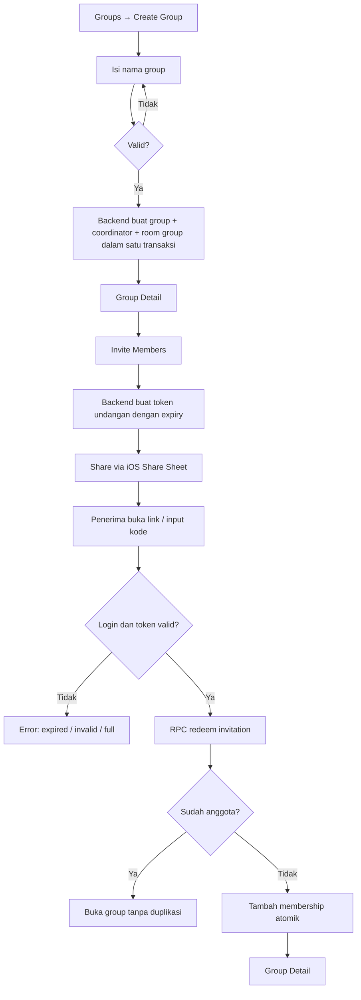
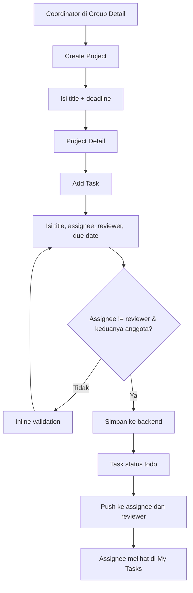
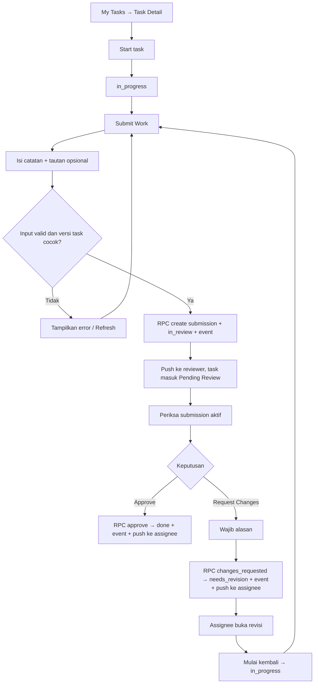
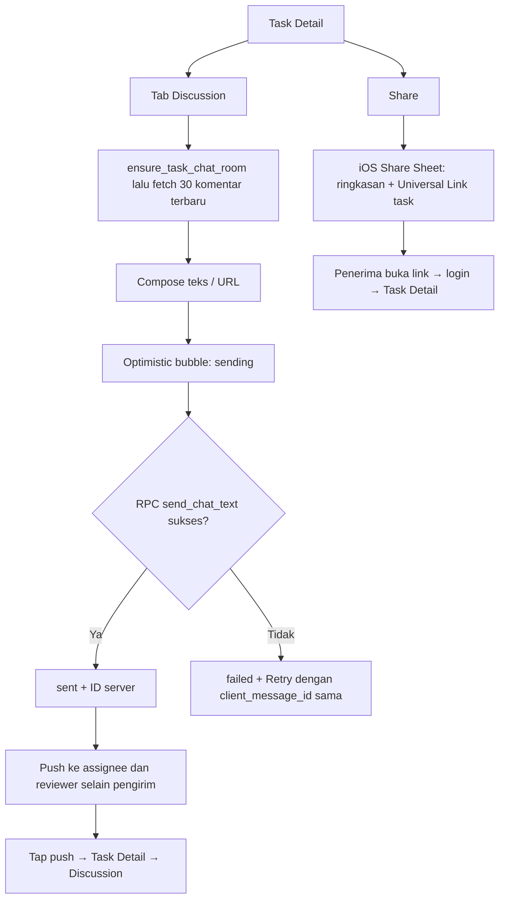

# GROUPLY: User Flow & Information Architecture

> **Versi:** 1.3 · **Tanggal:** 16 Oktober 2026 · **Status:** Rancangan MVP  
> [PRD](PRD.md) · [Design System](DESIGN_SYSTEM.md) · [Architecture](ARCHITECTURE.md)

## Keputusan v1.3 yang telah direkonsiliasi

- **Navigasi:** 4 tab: Beranda · Grup · Chat · Tugas Saya. Profil dibuka dari avatar di Beranda. Auth (Welcome, Masuk, Memulihkan sesi, Sesi berakhir, Gagal masuk) di luar tab.
- **Grup → Detail Grup** → Anggota · Pengaturan grup · Chat grup · Proyek (filter Aktif / Selesai / Arsip) → Detail Proyek → Detail Tugas (Ringkasan · Hasil kerja · Diskusi).
- **Detail Tugas → ⋯ Opsi tugas:** Edit tugas (koordinator), Alihkan pelaksana, Bagikan.
- **Proyek selesai:** banner "Proyek ini sudah selesai. Buka kembali proyek untuk mengubah tugas." + aksi "Buka Kembali Proyek" (konfirmasi). Mencoba membuat tugas memunculkan penjelasan, tidak membuka kembali otomatis.
- **Proyek diarsipkan:** banner "Proyek ini telah diarsipkan. Informasi dan riwayatnya tetap dapat dilihat." + "Pulihkan Proyek". Diskusi tugas hanya-baca pada proyek selesai maupun arsip; chat grup tetap aktif.
- **Alihkan saat review:** dialog "Sedang Menunggu Review", tidak ada perubahan data.
- **Undangan:** koordinator membuat kode → salin/bagikan/nonaktifkan → anggota memasukkan kode. Pesan: aktif, kedaluwarsa, tidak berlaku (dinonaktifkan/batas pakai/grup hilang), sudah bergabung, grup penuh.
- **Pesan:** tekan lama → Salin, Laporkan pesan, Blokir pengguna. Pesan dari pengguna yang diblokir disembunyikan dengan opsi Tampilkan.


## Status implementasi dan batas verifikasi

Per 17 Oktober 2026 tersedia dua mode: demo lokal dan **server Supabase lokal**. Server memakai Auth, PostgreSQL, RLS, RPC transactional dan integrasi SwiftUI async; workflow tiga akun telah diuji melalui SQL, HTTP dan client native. Deployment cloud, login Apple dengan provider nyata, Realtime, APNs, Universal Links, moderasi operasional dan penghapusan akun server belum diverifikasi/tersedia. Lihat [Backend Setup](BACKEND_SETUP.md) untuk implementasi aktual; bagian lain mendeskripsikan target produk P0.


## 1. Struktur navigasi

```text
App Root
├── Welcome / Sign in with Apple (belum login)
└── Main TabView (sudah login)
    ├── Home
    │   ├── Needs Attention → Task Detail / Review
    │   ├── Review pending > 48 jam (coordinator) → Task Detail
    │   └── Active Project → Project Detail
    ├── Groups
    │   ├── Create Group [sheet]
    │   ├── Join by Invite [sheet / Universal Link]
    │   └── Group Detail
    │       ├── Members / Invite [push/sheet]
    │       ├── Project List
    │       └── Project Detail
    │           ├── Task List
    │           ├── Group Pulse
    │           └── Task Detail
    │               ├── Overview
    │               ├── Submission & Review
    │               ├── Task Discussion
    │               └── Share [iOS Share Sheet]
    ├── Chat → Group Chat → aktivitas → Task Detail
    └── My Tasks
        └── Task Detail → Submit / Review / Discussion

Profile & Settings (notifikasi, blocked users, delete account) lewat avatar di Home.
Tap push notification → Task Detail yang relevan.
P0: Group Chat menargetkan Realtime; Task Discussion memakai fetch/pull to refresh/foreground/push.
```

MVP memakai empat tab: Beranda, Grup, Chat, Tugas Saya. Diskusi tugas tetap menempel pada task; percakapan umum ada di Group Chat.

## 2. Alur pertama kali membuka aplikasi



**Kriteria:** penolakan izin Apple / pembatalan login tidak boleh membuat app macet. Nama tampilan hanya diminta bila belum ada, tidak meminta akses kontak/foto atau izin notifikasi di layar pertama.

## 3. Flow membuat dan mengundang group



- Maksimum 8 anggota per group pada MVP.
- Link undangan memakai Universal Link `https://<domain>/invite/<token>` agar bisa dibuka langsung dari WhatsApp.
- Penerima tautan yang belum login menyimpan konteks invite sampai autentikasi selesai.
- Coordinator dapat merevoke token yang belum dipakai.
- Bila anggota dikeluarkan, query dan RPC berikutnya ditolak; client menutup layar group/task terkait, membersihkan cache, dan berhenti menerima push untuk group itu.

## 4. Flow proyek dan task



Tidak perlu label priority pada MVP; informasi paling penting adalah **status, assignee, reviewer, deadline**. Boleh menampilkan project list kosong dan CTA `Add first task`.

### Reassign assignee / reviewer

- Coordinator membuka Task Detail → **Reassign**.
- Ganti assignee maupun reviewer ditolak pada `in_review` dan `done`, atau proyek selesai/arsip.
- Pada `needs_revision`, konfirmasi pengalihan mempertahankan status revisi dan penulis submission lama. Pada `todo`/`in_progress`, pengalihan kembali ke `todo`.
- Assignee dan reviewer baru tetap wajib berbeda dan sama-sama anggota group.

## 5. Flow submission dan peer review



**Aturan:** satu reviewer ditunjuk sejak task dibuat; ia tidak boleh sama dengan assignee; review hanya bisa pada revision yang aktif, tidak pada versi historis. Dua keputusan simultan harus menghasilkan satu kemenangan dan satu error `stale_version`, bukan dua hasil final. Jika task `in_review` lebih dari 48 jam, Home coordinator menampilkan penanda **Review pending**.

## 6. Task Discussion, notifikasi, dan berbagi



**Detail penting:**
- Task Discussion dibuat *lazy* saat pertama dibuka, dan bisa diakses dari Task Detail, My Tasks, serta Project Detail.
- Group Chat menargetkan Realtime P0. Task Discussion di-refresh saat dibuka, pull to refresh, foreground, dan push terkait.
- Refresh mengambil komentar lebih baru dari cursor terakhir, lalu merge berdasarkan ID dan dedupe. Pagination ke atas memakai cursor `(created_at, id)`.
- System event submit/approve/revision muncul di thread task terkait sebagai item sistem.
- Pengiriman ulang memakai `client_message_id` **yang sama** agar tidak menciptakan komentar ganda.
- Share ke WhatsApp hanya berisi judul task, status, dan link. Penerima tetap harus login dan menjadi anggota untuk membuka isinya.
- Izin push diminta setelah user pertama kali join group atau mendapat task, dengan layar penjelasan singkat sebelum dialog sistem iOS. Jika ditolak, jangan tanya ulang otomatis.
- Push hanya memuat jenis event dan judul task, tanpa isi komentar atau catatan submission.
- Pengingat deadline H-1 memakai local notification untuk task milik sendiri yang belum `done`, dijadwalkan ulang setiap app dibuka atau data task berubah.

## 7. State UX per layar

| Screen | Loading | Empty | Error/offline | Success |
|---|---|---|---|---|
| Home | Skeleton ringan | CTA Create/Join | Retry & penanda koneksi | Ringkasan aktif |
| Groups | Spinner awal | Create/Join group | Tidak bisa membuat grup saat offline | Daftar group |
| Project | Placeholder task | Add first task | Data terakhir + refresh | Daftar task + progres |
| Task | Loading detail | Tidak relevan | Permission revoked / stale task | Status dan submission |
| Task Discussion | Membuat room / memuat 30 komentar | Tulis pembahasan pertama | Comment failed + Retry, banner offline | Diskusi per task + pull to refresh |
| Izin notifikasi | Tidak relevan | Tidak relevan | Izin ditolak: info ringan di Settings, app tetap jalan | Push aktif |
| Invite | Validasi token | Tidak relevan | Expired/invalid/full | Berhasil join |

Error di backend wajib diterjemahkan ke pesan pengguna, misalnya `Undangan sudah tidak berlaku`, `Proyek ini tidak dapat diakses`, dan `Task berubah, muat ulang untuk melanjutkan`.

## 8. Permission dan perilaku khusus

| Aksi | Coordinator | Member assignee | Member reviewer | Member lain |
|---|---|---|---|---|
| Baca group/project/task | Ya | Ya | Ya | Ya |
| Buat group/project/assign task | Ya | Tidak | Tidak | Tidak |
| Kirim hasil task | Hanya bila assignee | Ya | Tidak | Tidak |
| Review hasil task | Hanya bila reviewer dan bukan author | Tidak untuk submission sendiri | Ya | Tidak |
| Kirim komentar task | Ya | Ya | Ya | Ya |
| Reassign assignee/reviewer | Ya | Tidak | Tidak | Tidak |
| Kelola invite dan membership | Ya | Tidak | Tidak | Tidak |
| Report & block user | Ya | Ya | Ya | Ya |

Tabel ini hanya berlaku bagi anggota aktif; semua mutasi task/review/diskusi ditolak bila proyek selesai/arsip. Edit/reassign hanya pada todo/in_progress/needs_revision.

Semua izin tetap diverifikasi **server-side**. Menyembunyikan tombol tidak cukup untuk security.

## 9. Flow keluar / penghapusan akun

- Member: `Group Settings → Leave Group → Confirm` → `leave_group(group_id)` memeriksa membership aktif, peran, dan tugas aktif. Jika masih assignee/reviewer tugas aktif, minta reassignment dahulu. Tugas `in_review` memblokir keluar/remove; pengalihan baru boleh setelah keputusan review.
- Coordinator: `Transfer coordinator → Leave`, atau secara eksplisit hapus group jika policy retensi disetujui dan penghapusan group diimplementasikan.
- Account deletion: cek group yang masih dikoordinasi, jelaskan dampak pada data bersama, anonimisasi identitas di riwayat bersama sesuai kebijakan, lalu hapus autentikasi dan data pribadi via backend.
- User yang sudah tidak punya akses tidak boleh melihat diskusi melalui cache; bersihkan cache, cabut token push, dan hapus pengingat lokal saat sign out / revoke.

## 10. Deep link dan pemulihan konteks

| Link | Tujuan | Jika belum login | Jika akses dicabut |
|---|---|---|---|
| `https://<domain>/invite/<token>` | Join group | Login → redeem | Jelaskan token invalid/expired |
| `https://<domain>/task/<id>` | Task Detail (dari share & push) | Login → validasi | Access denied |
| `https://<domain>/group/<id>` | Group Detail | Login → validasi | Access denied |
| `grouply://...` | Fallback internal, tidak dibagikan ke publik | Login → validasi | Access denied |

Universal Links butuh domain milik sendiri dengan file `apple-app-site-association` di `/.well-known/` serta capability **Associated Domains** di Xcode. Siapkan sebelum mengerjakan fitur invite. Jika app belum terpasang, domain menampilkan halaman sederhana berisi link TestFlight / App Store. Link chat room (`/chat/<room-id>`) termasuk target P0 dan selalu memeriksa membership.

## 11. Skenario usability prioritas

1. User baru dapat membuat group dan mengundang teman dalam ≤2 menit (target penelitian).
2. Member menemukan tugas pribadi dalam ≤15 detik.
3. Reviewer menyelesaikan approve/minta revisi tanpa perlu mengirim pesan terpisah.
4. Member menemukan diskusi sebuah task langsung dari Task Detail.
5. Pengguna dengan jaringan buruk paham apakah komentarnya sudah terkirim atau gagal.
6. Reviewer membuka review langsung dari push notification dalam ≤2 tap.
