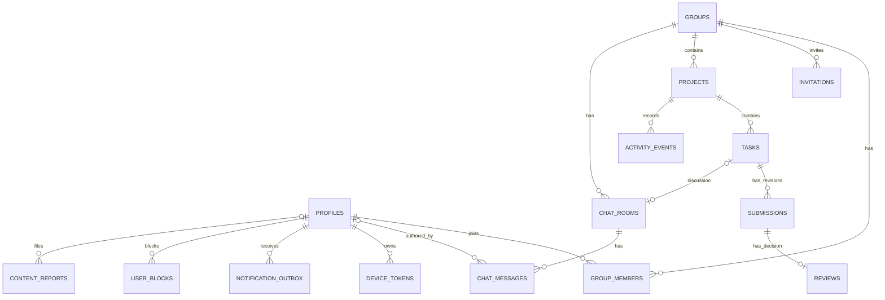

# GROUPLY: Database Schema & Authorization Blueprint

> **Versi:** 1.3 · **Tanggal:** 16 Oktober 2026 · **Database:** Supabase PostgreSQL  
> **Status:** Desain dan DDL dasar, **bukan migration production siap jalan tanpa RPC dan tests**.  
> [PRD](PRD.md) · [Architecture](ARCHITECTURE.md) · [User Flow](USER_FLOW.md) · [Roadmap](ROADMAP.md)

## Perubahan v1.3 (menggantikan bagian yang bertentangan di bawah)

Model konseptual tambahan / perubahan (tanpa infrastruktur baru):
- `projects`: `status` (`active` | `completed`) dipisah dari `archived_at timestamptz null`. Arsip tidak menimpa status, sehingga pemulihan otomatis kembali ke status sebelumnya. `completed_at`, `reopened_at` opsional.
- `invites`: `id, group_id, code, created_by, created_at, expires_at (default now()+7 hari), revoked_at null, max_uses (default 1), use_count`. Valid bila `now() < expires_at`, `revoked_at is null`, `use_count < max_uses`, grup ada, dan user belum anggota. `redeem_invite` mengunci baris (`for update`).
- `task_submissions` tetap append-only (revisi 1..n, penulis asli disimpan); pengalihan tugas tidak mengubah `author_id` lama.
- `audit_events`: `id, group_id, actor_id, entity_type, entity_id, action, payload jsonb, created_at` untuk edit tugas, pengalihan, selesai/buka kembali, arsip/pulihkan, undangan.
- `blocks` (blocker_id, blocked_id) dan `message_reports` (message_id, reporter_id, reason, details, created_at) masuk MVP.
- RLS/RPC menolak mutasi tugas bila proyek `completed` atau `archived_at is not null`, dan menolak pengalihan saat status `in_review`/`done`.


## 1. Prinsip dan batasan

- Multi-tenant lewat `groups` dan `group_members`. Semua query ber-RLS.
- UUID sebagai primary key, timestamp `timestamptz` dalam UTC.
- `auth.users` menjadi identitas autentikasi, `profiles` menyimpan nama tampilan minimal.
- Sistem mendukung 2–8 anggota per group; **batas 8 ditegakkan di RPC join secara atomik**, bukan hanya client.
- Mutasi data kritis hanya melalui **SECURITY DEFINER RPC terotorisasi** yang memeriksa membership/role sendiri.
- Tabel hanya diberi SELECT ber-RLS untuk pengguna; `invitations` tidak bisa dibaca langsung.
- Chat text dan pesan sistem sama-sama ditulis via **RPC**, bukan `INSERT` dari aplikasi. Ini memungkinkan rate limiting dan mencegah pemalsuan pesan sistem.
- Isi pesan chat disimpan di server dengan akses terkontrol; **belum end-to-end encrypted**. Jangan mengiklankan E2EE.
- Push notification lewat `notification_outbox` yang ditulis RPC dalam transaksi yang sama; pengiriman dilakukan Edge Function di server.
- MVP **tidak memakai Realtime**. Publikasi Realtime baru diaktifkan di P1 bersama Group Chat.

## 2. Entitas dan hubungan



**Total: 15 tabel.** 11 inti: `profiles`, `groups`, `group_members`, `invitations`, `projects`, `tasks`, `submissions`, `reviews`, `activity_events`, `chat_rooms`, `chat_messages`. 4 pendukung notifikasi dan safety: `device_tokens`, `notification_outbox`, `user_blocks`, `content_reports`.

## 3. Data dictionary

| Tabel | Kolom penting | Syarat utama |
|---|---|---|
| `profiles` | `id`, `display_name` | `id = auth.users.id` |
| `groups` | `id`, `name`, `description`, `created_by` | Memiliki 1 coordinator aktif |
| `group_members` | `group_id`, `user_id`, `role` | Unik `(group_id,user_id)`, role `coordinator/member` |
| `invitations` | `group_id`, `token_hash`, `expires_at`, `max_uses`, `used_count`, `revoked_at` | Hash token tidak dikirim melalui SELECT |
| `projects` | `group_id`, `title`, `due_at`, `status` | `active/completed/archived` |
| `tasks` | `project_id`, `assignee_id`, `reviewer_id`, `due_at`, `status`, `version` | Reviewer ≠ assignee; status terkunci RPC |
| `submissions` | `task_id`, `author_id`, `revision_number`, `note`, `links`, `client_submission_id` | Revisi unik per task; retry idempoten |
| `reviews` | `submission_id`, `reviewer_id`, `decision`, `feedback`, `client_review_id` | Satu review per submission |
| `activity_events` | `project_id`, `actor_id`, `event_type`, `payload`, `task_id` | Append-only melalui RPC/trigger |
| `chat_rooms` | `group_id`, `task_id?`, `room_type` | Satu group room / satu task room |
| `chat_messages` | `room_id`, `sender_id?`, `message_type`, `content`, `metadata`, `client_message_id?` | Retry idempoten untuk text; system backend-only |
| `device_tokens` | `token`, `user_id`, `environment` | Satu token hanya milik satu user; tidak terbaca client |
| `notification_outbox` | `recipient_id`, `kind`, `task_id`, `attempts`, `sent_at` | Ditulis RPC, dibaca Edge Function; tanpa isi komentar |
| `user_blocks` | `blocker_id`, `blocked_id` | Hanya terbaca pemblokir; dipakai RLS `chat_messages` |
| `content_reports` | `reporter_id`, `target_type`, `target_id`, `reason`, `status` | Tidak terbaca client |

`assignee_id`/`reviewer_id` dibuat nullable **pada level DB** agar riwayat tugas yang sudah selesai tetap dapat dianonimkan bila pengguna menghapus akun. Namun RPC pembuatan task **wajib** menerima keduanya, sedangkan task aktif tanpa penanggung jawab harus ditangani lewat reassignment sebelum member keluar/deletion. `sender_id` juga nullable ketika identitas pengirim dihapus, tetapi teks historis dapat tetap tersedia untuk anggota group sesuai kebijakan retensi.

## 4. SQL DDL dasar

SQL di bawah menunjukkan kontrak struktur. Jalankan di **database development** menggunakan migration terurut; setelahnya wajib menerapkan **RPC, permissions, dan integration tests**. Jangan copy satu blok ini ke production dan menganggap semuanya selesai.

```sql
create extension if not exists pgcrypto;

create table public.profiles (
  id uuid primary key references auth.users(id) on delete cascade,
  display_name text not null check (char_length(btrim(display_name)) between 1 and 60),
  created_at timestamptz not null default now(),
  updated_at timestamptz not null default now()
);

create table public.groups (
  id uuid primary key default gen_random_uuid(),
  name text not null check (char_length(btrim(name)) between 1 and 80),
  description text check (char_length(description) <= 500),
  created_by uuid references public.profiles(id) on delete set null,
  created_at timestamptz not null default now()
);

create table public.group_members (
  group_id uuid not null references public.groups(id) on delete cascade,
  -- restrict: profil/akun tidak bisa terhapus selama masih member; deletion wajib lewat workflow
  user_id uuid not null references public.profiles(id) on delete restrict,
  role text not null check (role in ('coordinator', 'member')),
  joined_at timestamptz not null default now(),
  primary key (group_id, user_id)
);
create unique index group_one_coordinator
  on public.group_members(group_id) where role = 'coordinator';
create index group_members_by_user on public.group_members(user_id, group_id);

-- Unique index di atas hanya menjamin "maksimal satu". Trigger ini menjamin "tepat satu"
-- di akhir transaksi, sehingga create_group dan transfer_coordinator tetap bisa berjalan.
create or replace function public.assert_one_coordinator()
returns trigger language plpgsql set search_path = ''
as $$
declare g uuid := coalesce(new.group_id, old.group_id);
begin
  if exists (select 1 from public.groups where id = g)
     and (select count(*) from public.group_members
          where group_id = g and role = 'coordinator') <> 1 then
    raise exception 'group % must have exactly one coordinator', g
      using errcode = 'check_violation';
  end if;
  return null;
end $$;

create constraint trigger group_has_one_coordinator
after insert or update or delete on public.group_members
deferrable initially deferred
for each row execute function public.assert_one_coordinator();

create table public.invitations (
  id uuid primary key default gen_random_uuid(),
  group_id uuid not null references public.groups(id) on delete cascade,
  token_hash bytea not null unique,
  created_by uuid references public.profiles(id) on delete set null,
  expires_at timestamptz not null,
  max_uses integer not null default 8 check (max_uses between 1 and 8),
  used_count integer not null default 0 check (used_count >= 0 and used_count <= max_uses),
  revoked_at timestamptz,
  created_at timestamptz not null default now()
);
create index invitations_by_group on public.invitations(group_id);

create table public.projects (
  id uuid primary key default gen_random_uuid(),
  group_id uuid not null references public.groups(id) on delete cascade,
  title text not null check (char_length(btrim(title)) between 1 and 120),
  description text check (char_length(description) <= 2000),
  due_at timestamptz not null,
  status text not null default 'active'
    check (status in ('active', 'completed', 'archived')),
  created_by uuid references public.profiles(id) on delete set null,
  created_at timestamptz not null default now(),
  updated_at timestamptz not null default now()
);
create index projects_by_group on public.projects(group_id, due_at);

create table public.tasks (
  id uuid primary key default gen_random_uuid(),
  project_id uuid not null references public.projects(id) on delete cascade,
  title text not null check (char_length(btrim(title)) between 1 and 160),
  description text check (char_length(description) <= 4000),
  assignee_id uuid references public.profiles(id) on delete set null,
  reviewer_id uuid references public.profiles(id) on delete set null,
  due_at timestamptz not null,
  status text not null default 'todo'
    check (status in ('todo', 'in_progress', 'in_review', 'needs_revision', 'done')),
  version integer not null default 1 check (version >= 1),
  created_by uuid references public.profiles(id) on delete set null,
  created_at timestamptz not null default now(),
  updated_at timestamptz not null default now(),
  constraint different_assignee_reviewer
    check (assignee_id is null or reviewer_id is null or assignee_id <> reviewer_id)
);
create index tasks_by_project on public.tasks(project_id, status, due_at);
create index tasks_by_assignee on public.tasks(assignee_id, due_at);
create index tasks_by_reviewer on public.tasks(reviewer_id, status);

create table public.submissions (
  id uuid primary key default gen_random_uuid(),
  task_id uuid not null references public.tasks(id) on delete cascade,
  author_id uuid references public.profiles(id) on delete set null,
  revision_number integer not null check (revision_number > 0),
  note text not null check (char_length(btrim(note)) between 1 and 4000),
  -- maksimal 5 link, semuanya string https://. Panjang per link (<= 2048) dicek di RPC.
  links jsonb not null default '[]'::jsonb
    check (case when jsonb_typeof(links) = 'array'
                then jsonb_array_length(links) <= 5
                     and not jsonb_path_exists(links,
                       '$[*] ? (@.type() != "string" || !(@ like_regex "^https://[^[:space:]]+$"))')
                else false end),
  client_submission_id uuid not null unique,
  submitted_at timestamptz not null default now(),
  unique (task_id, revision_number)
);
create index submissions_by_task on public.submissions(task_id, revision_number desc);

create table public.reviews (
  id uuid primary key default gen_random_uuid(),
  submission_id uuid not null unique references public.submissions(id) on delete cascade,
  reviewer_id uuid references public.profiles(id) on delete set null,
  decision text not null check (decision in ('approved', 'changes_requested')),
  feedback text,
  client_review_id uuid not null unique,
  created_at timestamptz not null default now(),
  check (decision <> 'changes_requested' or
         (feedback is not null and char_length(btrim(feedback)) between 1 and 2000))
);

create table public.activity_events (
  id uuid primary key default gen_random_uuid(),
  project_id uuid not null references public.projects(id) on delete cascade,
  task_id uuid references public.tasks(id) on delete set null,
  actor_id uuid references public.profiles(id) on delete set null,
  event_type text not null check (event_type in (
    'project_created', 'task_created', 'task_assigned', 'task_started',
    'submission_created', 'review_approved', 'review_changes_requested',
    'task_reopened', 'task_reassigned', 'project_archived'
  )),
  payload jsonb not null default '{}'::jsonb,
  created_at timestamptz not null default now()
);
create index activity_by_project on public.activity_events(project_id, created_at desc);

create table public.chat_rooms (
  id uuid primary key default gen_random_uuid(),
  group_id uuid not null references public.groups(id) on delete cascade,
  task_id uuid references public.tasks(id) on delete cascade,
  room_type text not null check (room_type in ('group', 'task')),
  created_at timestamptz not null default now(),
  constraint chat_room_shape check (
    (room_type = 'group' and task_id is null) or
    (room_type = 'task' and task_id is not null)
  )
);
create unique index one_group_room on public.chat_rooms(group_id)
  where room_type = 'group';
create unique index one_task_room on public.chat_rooms(task_id)
  where room_type = 'task';

create table public.chat_messages (
  id uuid primary key default gen_random_uuid(),
  room_id uuid not null references public.chat_rooms(id) on delete cascade,
  sender_id uuid references public.profiles(id) on delete set null,
  message_type text not null check (message_type in ('text', 'system')),
  content text not null,
  metadata jsonb not null default '{}'::jsonb,
  client_message_id uuid,
  created_at timestamptz not null default now(),
  constraint chat_message_shape check (
    (message_type = 'text'
      and char_length(btrim(content)) between 1 and 2000
      and metadata = '{}'::jsonb
      and (sender_id is null or client_message_id is not null))
    or
    (message_type = 'system'
      and sender_id is null
      and client_message_id is null
      and char_length(btrim(content)) between 1 and 500)
  )
);
create unique index unique_client_message
  on public.chat_messages(sender_id, client_message_id)
  where client_message_id is not null and sender_id is not null;
create index chat_messages_by_room_cursor
  on public.chat_messages(room_id, created_at desc, id desc);

create table public.device_tokens (
  token text primary key check (char_length(token) between 32 and 200),
  user_id uuid not null references public.profiles(id) on delete cascade,
  environment text not null check (environment in ('sandbox', 'production')),
  updated_at timestamptz not null default now()
);
create index device_tokens_by_user on public.device_tokens(user_id);

create table public.notification_outbox (
  id uuid primary key default gen_random_uuid(),
  recipient_id uuid not null references public.profiles(id) on delete cascade,
  kind text not null check (kind in (
    'task_assigned', 'submission_created', 'review_approved',
    'review_changes_requested', 'comment_created'
  )),
  task_id uuid references public.tasks(id) on delete cascade,
  payload jsonb not null default '{}'::jsonb,  -- hanya id/metadata, tanpa isi komentar
  attempts integer not null default 0 check (attempts between 0 and 10),
  sent_at timestamptz,
  created_at timestamptz not null default now()
);
create index outbox_pending on public.notification_outbox(created_at)
  where sent_at is null;

create table public.user_blocks (
  blocker_id uuid not null references public.profiles(id) on delete cascade,
  blocked_id uuid not null references public.profiles(id) on delete cascade,
  created_at timestamptz not null default now(),
  primary key (blocker_id, blocked_id),
  check (blocker_id <> blocked_id)
);

create table public.content_reports (
  id uuid primary key default gen_random_uuid(),
  reporter_id uuid references public.profiles(id) on delete set null,
  target_type text not null check (target_type in ('message', 'user', 'submission')),
  target_id uuid not null,
  group_id uuid references public.groups(id) on delete set null,
  reason text not null check (char_length(btrim(reason)) between 1 and 1000),
  status text not null default 'open' check (status in ('open', 'reviewed', 'actioned')),
  created_at timestamptz not null default now()
);
```

**Invariant yang tidak cukup ditangani CHECK/FK:** `chat_rooms.task_id` harus menunjuk task yang proyeknya berada di `chat_rooms.group_id`; assignee/reviewer harus menjadi group members; setiap group memiliki tepat satu coordinator; limit 8 orang; status/revision tidak boleh melompati state machine. Semua diperiksa dalam transactional RPC dan bila memungkinkan ditambah trigger invariant sebagai lapisan kedua.

### Mengapa timestamp dan penghapusan identitas seperti ini?

Riwayat chat/submission/review bisa tetap dibutuhkan anggota lain, tetapi identitas pengguna yang menghapus akun harus dapat dianonimkan. Kolom author/sender nullable mengakomodasi itu. Sebaliknya, `group_members.user_id` sengaja `restrict`: profil dan akun auth tidak bisa terhapus selama user masih anggota group, sehingga penghapusan wajib melewati workflow yang memindahkan peran coordinator dan task aktif terlebih dahulu. **Kebijakan retensi pesan dan hapus group harus disahkan sebelum public release**; referensi FK saja bukan keseluruhan deletion policy.

## 5. RLS: pola implementasi

### Enable RLS dan kunci hak tulis tabel

```sql
do $$
declare t text;
begin
  foreach t in array array[
    'profiles','groups','group_members','invitations','projects','tasks',
    'submissions','reviews','activity_events','chat_rooms','chat_messages',
    'device_tokens','notification_outbox','user_blocks','content_reports'
  ] loop
    execute format('alter table public.%I enable row level security', t);
    execute format('revoke all on table public.%I from anon, authenticated', t);
  end loop;
end $$;

-- SELECT hanya untuk tabel yang memang perlu ditampilkan di app:
grant select on public.profiles, public.groups, public.group_members,
  public.projects, public.tasks, public.submissions, public.reviews,
  public.activity_events, public.chat_rooms, public.chat_messages,
  public.user_blocks
  to authenticated;

-- Tidak ada SELECT langsung atas invitations, device_tokens, notification_outbox, content_reports.
-- Tidak ada direct INSERT/UPDATE/DELETE. Edge Function membaca token/outbox dengan service role di server.
-- Tindakan tulis via RPC tertentu dengan GRANT EXECUTE eksplisit.
```

**Catatan Supabase:** grants dan RLS adalah dua gerbang berbeda; `anon` tidak mendapat hak tabel. Definer RPC milik role terpercaya dapat bekerja ketika client ditolak menulis langsung; RPC harus mengautentikasi caller secara eksplisit.

### Helper untuk menghindari recursive RLS

```sql
create or replace function public.is_group_member(p_group uuid)
returns boolean
language sql stable security definer set search_path = ''
as $$
  select (select auth.uid()) is not null and exists (
    select 1 from public.group_members gm
    where gm.group_id = p_group
      and gm.user_id = (select auth.uid())
  );
$$;

create or replace function public.can_access_project(p_project uuid)
returns boolean
language sql stable security definer set search_path = ''
as $$
  select exists (
    select 1 from public.projects p
    where p.id = p_project
      and public.is_group_member(p.group_id)
  );
$$;

create or replace function public.can_access_task(p_task uuid)
returns boolean
language sql stable security definer set search_path = ''
as $$
  select exists (
    select 1 from public.tasks t
    where t.id = p_task and public.can_access_project(t.project_id)
  );
$$;

create or replace function public.can_access_room(p_room uuid)
returns boolean
language sql stable security definer set search_path = ''
as $$
  select exists (
    select 1 from public.chat_rooms r
    where r.id = p_room and public.is_group_member(r.group_id)
  );
$$;

create or replace function public.shares_group_with(p_other uuid)
returns boolean
language sql stable security definer set search_path = ''
as $$
  select (select auth.uid()) = p_other or exists (
    select 1 from public.group_members me
    join public.group_members other on me.group_id = other.group_id
    where me.user_id = (select auth.uid()) and other.user_id = p_other
  );
$$;

revoke all on function public.is_group_member(uuid) from public, anon, authenticated;
revoke all on function public.can_access_project(uuid) from public, anon, authenticated;
revoke all on function public.can_access_task(uuid) from public, anon, authenticated;
revoke all on function public.can_access_room(uuid) from public, anon, authenticated;
revoke all on function public.shares_group_with(uuid) from public, anon, authenticated;
grant execute on function public.is_group_member(uuid),
  public.can_access_project(uuid), public.can_access_task(uuid),
  public.can_access_room(uuid), public.shares_group_with(uuid)
  to authenticated;
```

Security-definer helper dibuat dengan `search_path = ''` dan nama tabel fully qualified. **Pemilik function harus role terpercaya** dan function tidak boleh menawarkan akses lintas tenant. Jika role caller `anon`, `auth.uid()` null sehingga hasil false.

### SELECT policies inti

```sql
create policy profiles_read on public.profiles
for select to authenticated
using (public.shares_group_with(id));

create policy groups_read on public.groups
for select to authenticated
using (public.is_group_member(id));

create policy memberships_read on public.group_members
for select to authenticated
using (public.is_group_member(group_id));

create policy projects_read on public.projects
for select to authenticated
using (public.is_group_member(group_id));

create policy tasks_read on public.tasks
for select to authenticated
using (public.can_access_project(project_id));

create policy submissions_read on public.submissions
for select to authenticated
using (public.can_access_task(task_id));

create policy reviews_read on public.reviews
for select to authenticated
using (exists (
  select 1 from public.submissions s
  where s.id = submission_id and public.can_access_task(s.task_id)
));

create policy activity_read on public.activity_events
for select to authenticated
using (public.can_access_project(project_id));

create policy rooms_read on public.chat_rooms
for select to authenticated
using (public.is_group_member(group_id));

create policy messages_read on public.chat_messages
for select to authenticated
using (
  public.can_access_room(room_id)
  and not exists (
    select 1 from public.user_blocks b
    where b.blocker_id = (select auth.uid())
      and b.blocked_id = chat_messages.sender_id
  )
);

create policy blocks_read on public.user_blocks
for select to authenticated
using (blocker_id = (select auth.uid()));
```

Belum ada policy INSERT/UPDATE/DELETE untuk client karena semua mutasi memakai RPC. Jangan membuat policy `USING (true)` atau melepas RLS sekadar agar development lebih cepat.

## 6. RPC, constraints bisnis, dan concurrency

| RPC | Pola transaksi & validasi |
|---|---|
| `create_group` | `auth.uid()` ada; buat group, member coordinator, group chat **dalam satu transaksi** |
| `create_group_invite` | cek role coordinator, buat token CSPRNG, simpan hanya hash; kembalikan token mentah sekali |
| `redeem_group_invite` | cari hash, `SELECT ... FOR UPDATE`, cek expiry/revoke/used_count, lock group atau membership count, limit 8, insert member, naikkan uses |
| `remove_group_member` | coordinator saja; tolak jika target punya task aktif yang belum direassign; jangan tinggalkan group tanpa coordinator |
| `transfer_coordinator` | lock group; ubah role lama ke member lalu baru role baru coordinator agar partial unique tetap valid |
| `create_project` / `create_task` | coordinator saja; validasi deadline/fields dan keanggotaan assignee/reviewer; task reviewer berbeda |
| `start_task` | assignee; `todo`/`needs_revision` → `in_progress`; version compare |
| `submit_work` | lock task, validasi `in_progress`, idempotency key, link https & ≤2048 char, ambil revision terakhir, insert, update status/version, activity, system message di room task (ensure), outbox ke reviewer |
| `review_work` | lock task, reviewer yang ditunjuk, bukan submission author; check latest submission dan version; insert decision, update state, event + system message di room task + outbox ke assignee |
| `reopen_task` | coordinator; `done → todo`, increment version, event |
| `reassign_task` | coordinator; lock task + version; anggota valid dan berbeda; tolak ganti assignee saat `in_review`; ganti assignee → `todo`; event `task_reassigned` + outbox |
| `ensure_task_chat_room` | member yang valid; verifikasi task/group cocok; insert on conflict lalu return room |
| `send_chat_text` | cek membership room (MVP: room task saja), trimmed length 1–2000, **server-side rate limit**, idempotent client ID, insert hanya `text`, outbox ke assignee & reviewer kecuali pengirim |
| `upsert_my_profile` | tidak menerima arbitrary `user_id`; pakai `auth.uid()` saja |
| `register_device_token` / `unregister_device_token` | token diikat ke `auth.uid()`; upsert memindahkan kepemilikan; unregister hanya oleh pemilik |
| `block_user` / `unblock_user` | `auth.uid()` sebagai blocker; tidak bisa block diri sendiri |
| `report_content` | pelapor satu group dengan target; rate limit; tidak mengembalikan data target |
| `request_account_deletion` | transfer/cleanup prerequisite, anonimisasi shared history, hapus personal profile & auth via jalur server yang aman |

**Security contract untuk semua SECURITY DEFINER RPC:**
- `set search_path = ''`, gunakan schema-qualified names.
- `auth.uid()` divalidasi untuk setiap operasi.
- Re-check membership/role di dalam function; jangan mempercayai role dari client.
- `REVOKE EXECUTE FROM PUBLIC, anon` lalu `GRANT EXECUTE TO authenticated` hanya pada fungsi yang diperlukan.
- Return hanya informasi yang memang boleh diakses caller.
- Gunakan row locks pada operasi yang rentan race, serta `expected_version` untuk deteksi stale update.
- Pastikan sistem event ditulis dalam transaksi yang sama agar status dan chat konsisten.

### Pseudocode `review_work`

```text
BEGIN TRANSACTION
  assert current auth.uid exists
  find submission and task; SELECT task FOR UPDATE
  assert user is active member of project group
  assert task.reviewer_id = auth.uid
  assert submission.author_id != auth.uid
  assert task.status = 'in_review' and version = expected_version
  assert submission.id is newest revision of this task
  if client_review_id already exists:
     confirm same inputs and return prior result (idempotent)
  insert reviews row (unique submission_id)
  update task.status = done OR needs_revision, version += 1
  insert activity_event
  ensure task room; insert system message in task room with {task_id, event_id}
  insert notification_outbox for assignee
COMMIT
```

**Konsistensi group/task:** task room dibuat lewat RPC, bukan client bebas memilih group_id dan task_id. Kode RPC wajib memeriksa bahwa task → project → group menghasilkan group yang sama dengan room. Pertimbangkan trigger invariant jika ada jalur tulis server lain.

**Rate limit chat:** implementasikan di backend sebelum public pilot. Untuk versi sederhana, RPC mengunci per `(user_id, room_id)` dengan advisory transaction lock sebelum menghitung jumlah pesan 60 detik terakhir, lalu membatasi misalnya 20/menit. Pastikan idempotent retry diperiksa **sebelum** menghitung limit. Untuk skala lebih tinggi, gunakan store rate-limit dedicated.

## 7. Chat queries dan Realtime

**Fetch latest:**

```sql
select id, room_id, sender_id, message_type, content,
       metadata, client_message_id, created_at
from public.chat_messages
where room_id = :room_id
order by created_at desc, id desc
limit 30;
```

**Fetch older (keyset):**

```sql
select id, room_id, sender_id, message_type, content,
       metadata, client_message_id, created_at
from public.chat_messages
where room_id = :room_id
  and (created_at, id) < (:cursor_created_at, :cursor_id)
order by created_at desc, id desc
limit 30;
```

**Fetch newer (refresh MVP):**

```sql
select id, room_id, sender_id, message_type, content,
       metadata, client_message_id, created_at
from public.chat_messages
where room_id = :room_id
  and (created_at, id) > (:cursor_created_at, :cursor_id)
order by created_at asc, id asc
limit 100;
```

RLS tetap berlaku saat query dibuat dari client Supabase session, termasuk filter block. MVP tidak mengaktifkan publikasi Realtime sama sekali.

**Realtime (P1):** saat Group Chat dibuka, aktifkan publikasi hanya untuk `chat_messages`; gunakan insert events dan re-fetch untuk gap recovery. RLS SELECT memastikan akses sesuai membership.

**Penting (P1):** Realtime bukan push saat aplikasi ditutup dan bukan jaminan semua event diterima. Cek permission baru setelah revoke membership, resubscribe pada perubahan JWT, dan berhentikan room UI saat akses dicabut.

## 8. Data lifecycle, data minimization, retention

- Nama tampilan bisa berubah, tetapi ID user tetap immutable.
- Pesan group mungkin tetap tersedia setelah seorang anggota keluar; tentukan hak akses/retention sebelum rilis publik.
- User yang menghapus akun tidak otomatis boleh menghapus kontribusi milik anggota lain. Anonimisasi identitas pada rekam jejak shared diperlukan dan harus dijelaskan di privacy policy.
- Delete group (fitur setelah scope ditetapkan) perlu menghapus projects/tasks/messages sesuai cascade dan kebijakan ekspor/retention yang disetujui.
- `invitations.token_hash` sebaiknya hash token CSPRNG yang tidak bisa ditebak, bukan password biasa, dan raw token **tidak boleh** tercatat di log analytics.
- Hindari memasukkan isi pesan/screenshot pribadi ke log atau telemetry.
- Token push dihapus saat logout dan saat APNs melaporkan token tidak valid. Outbox yang sudah terkirim dibersihkan berkala.

## 9. Integration security tests yang wajib dibuat

1. User A bukan member group B: SELECT group/project/task/submission/chat B menghasilkan 0 data.
2. User A bukan member B: panggil `send_chat_text` untuk room B → forbidden.
3. Member biasa memanggil `create_task`/`create_group_invite` → forbidden.
4. Insert langsung `chat_messages`, termasuk `system`, ditolak oleh GRANT.
5. Reviewer yang sama dengan submission author → forbidden, bahkan jika fungsi dipanggil manual.
6. Dua request `review_work` bersamaan → satu sukses, satu `stale_version` / `already_reviewed`.
7. Retry `send_chat_text` dengan `client_message_id` identik → record sama, tidak duplicate.
8. Invite kadaluarsa/dicabut/8 anggota/usage habis → join ditolak.
9. Hapus membership saat diskusi terbuka → SELECT dan RPC selanjutnya ditolak.
10. Account deletion → data pribadi hilang sesuai kebijakan, foreign key/shared history tetap konsisten.
11. SQL injection tidak dimungkinkan melalui input karena prepared parameters / RPC typed inputs.
12. (P1) Query Realtime tidak melewati RLS atau membocorkan row pada group lain.
13. Hapus akun yang masih member group → ditolak oleh FK `restrict` sampai workflow keluar group selesai.
14. Transaksi yang meninggalkan group tanpa coordinator → gagal saat commit.
15. Submission dengan link `http:`, `javascript:`, atau lebih dari 5 link → ditolak oleh DB walau RPC dilewati.
16. User A tidak bisa membaca `device_tokens`, `notification_outbox`, `content_reports`, atau block milik user lain.
17. Komentar user yang diblok tidak muncul bagi pemblokir, tetapi tetap muncul bagi anggota lain.
18. `reassign_task` oleh member biasa → forbidden; ganti assignee saat `in_review` → ditolak.
19. Satu event menghasilkan tepat satu baris outbox per penerima; pengirim komentar tidak menerima push miliknya sendiri.

## 10. Yang belum termasuk dalam DDL ini

**Ini disengaja agar tidak memberi kesan migration sudah siap deploy.** Masih harus diimplementasikan dan diuji:

- SECURITY DEFINER RPC implementasi penuh beserta `GRANT EXECUTE` terkontrol.
- Invite token random dan hash handling, rate limiting, deep links.
- Trigger `updated_at`, invariant chat room→project→group, dan profil bootstrap bila dipilih.
- Account deletion workflow (auth admin operation dari server aman, bukan service key di app).
- Edge Function `send-push`, Database Webhook, APNs key di secrets, dan pembersihan outbox.
- Realtime publication config (P1), staging environment, backup/retention policy, dan monitoring.
- SQL migrations versioned, test suite, serta penyesuaian hak akses dengan konfigurasi Supabase project aktual.

## 11. Referensi resmi

- [Supabase RLS dan grants](https://supabase.com/docs/guides/database/postgres/row-level-security)
- [Supabase functions & security definer](https://supabase.com/docs/guides/database/functions)
- [Supabase Realtime Postgres Changes](https://supabase.com/docs/guides/realtime/postgres-changes)
- [Supabase Realtime Authorization](https://supabase.com/docs/guides/realtime/authorization)

> **Kesimpulan:** database mendukung kolaborasi dan chat dengan isolasi per-group. Sebelum rilis, semua invariant yang tidak dijaga oleh DDL harus benar-benar ditegakkan melalui RPC/trigger dan diuji multiakun.
